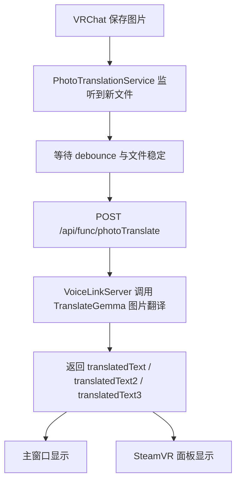

# 2026-04-12 VRChat 拍照翻译实现说明

## 目标

当前实现已经调整为：

1. 客户端监听 VRChat 拍照目录
2. 发现新图片后等待文件写入稳定
3. 上传图片到服务端 `/api/func/photoTranslate`
4. 服务端直接调用现有 TranslateGemma 多模态图片翻译能力
5. 把翻译结果显示到 VRCLS 主界面和 SteamVR 文本面板

这版实现不再走“先 OCR，再调用 `do_translate(...)`”的两段式流程。

## 当前实际链路



## 已实现内容

### 客户端

- 新增 `IPhotoTranslationService`
- 新增 `PhotoTranslationService`
- 默认监听目录：
  - `%USERPROFILE%\\Pictures\\VRChat`
- 支持配置覆盖：
  - `photoRootPath`
- 监听文件：
  - `VRChat_*.png`
  - `VRChat_*.jpg`
  - `VRChat_*.jpeg`
  - `VRChat_*.webp`
- 处理方式：
  - `FileSystemWatcher + debounce`
  - 连续检查文件长度稳定
  - 确认可读后再上传
- 结果接入：
  - 主窗口 Transcript
  - SteamVR Overlay 文本面板
- 当前不做：
  - VRChat Chatbox 自动发送
  - TTS 自动播报

### 服务端

- 新增接口：
  - `POST /api/func/photoTranslate`
- 服务端直接复用现有 TranslateGemma 配置：
  - `GEMMA_TRANSLATE_URL`
  - `GEMMA_TRANSLATE_API_MODE`
  - `GEMMA_TRANSLATE_MODEL`
  - `GEMMA_TRANSLATE_TIMEOUT`
  - `GEMMA_TRANSLATE_MAX_TOKENS`
- 图片翻译模式：
  - `completion` 模式下走 `/completion`
  - `openai` 模式下走 `/v1/chat/completions`
  - `auto` 时优先 `/completion`，失败后回退到 OpenAI 兼容接口

## 关键代码位置

### 客户端

- `D:\\git\\gitlab\\VRCLS-CSharp\\01.VRCLS.Core\\Interfaces\\IPhotoTranslationService.cs`
- `D:\\git\\gitlab\\VRCLS-CSharp\\01.VRCLS.Core\\Models\\AppConfig.cs`
- `D:\\git\\gitlab\\VRCLS-CSharp\\02.VRCLS.Services\\Photo\\PhotoTranslationService.cs`
- `D:\\git\\gitlab\\VRCLS-CSharp\\03.VRCLS.UI\\App.xaml.cs`
- `D:\\git\\gitlab\\VRCLS-CSharp\\03.VRCLS.UI\\ViewModels\\MainViewModel.cs`
- `D:\\git\\gitlab\\VRCLS-CSharp\\03.VRCLS.UI\\Converters\\SourceToColorConverter.cs`
- `D:\\git\\gitlab\\VRCLS-CSharp\\03.VRCLS.UI\\Converters\\ValueConverters.cs`

### 服务端

- `D:\\git\\gitlab\\VoiceLinkServer1\\src\\core\\gemma_translate_service.py`
- `D:\\git\\gitlab\\VoiceLinkServer1\\src\\core\\image_translate_service.py`
- `D:\\git\\gitlab\\VoiceLinkServer1\\src\\routers\\api.py`
- `D:\\git\\gitlab\\VoiceLinkServer1\\src\\core\\config.py`

## 接口说明

### 请求

`POST /api/func/photoTranslate`

表单字段：

- `file`
- `sourceLanguage`
- `targetLanguage`
- `targetLanguage2`
- `targetLanguage3`

### 响应

```json
{
  "text": "",
  "translatedText": "第一目标语言翻译",
  "translatedText2": "第二目标语言翻译",
  "translatedText3": "第三目标语言翻译",
  "detectedSourceLanguage": "auto"
}
```

说明：

- 当前是直接图片翻译，不再单独返回 OCR 原文
- 因此 `text` 默认留空
- `detectedSourceLanguage` 当前返回请求里的 `sourceLanguage`

## 客户端配置

```json
{
  "enablePhotoTranslation": true,
  "photoRootPath": ""
}
```

说明：

- `enablePhotoTranslation`
  - 是否启用拍照监听
- `photoRootPath`
  - 为空时使用 `%USERPROFILE%\\Pictures\\VRChat`
  - 如果用户改了 VRChat 图片目录，可手动覆盖

## 服务端配置

图片翻译现在直接走现有 Gemma 配置，不再使用单独的 `IMAGE_VISION_*` 配置。

最关键的是：

```env
GEMMA_TRANSLATE_ENABLED=True
GEMMA_TRANSLATE_URL=127.0.0.1:8080
GEMMA_TRANSLATE_API_MODE=completion
GEMMA_TRANSLATE_MODEL=translategemma-12b-it-MP-GGUF
GEMMA_TRANSLATE_TIMEOUT=10.0
GEMMA_TRANSLATE_MAX_TOKENS=500
```

如果你当前就是用
`D:\\git\\gitlab\\translategemma-llama-server-docker\\scripts\\test-image-translate.ps1`
测试成功的那套服务，那么这里应当直接复用同一地址和模型。

## 实现细节

### `completion` 模式

服务端会构造与你测试脚本一致的多模态请求格式：

- `POST /completion`
- `prompt.prompt_string`
- `prompt.multimodal_data = [base64图片]`

### `openai` 模式

服务端会构造 OpenAI 兼容的图片翻译请求：

- `POST /v1/chat/completions`
- `messages[0].content[0].type = "image"`
- 同时携带：
  - `source_lang_code`
  - `target_lang_code`
  - `url`

## 默认行为

- 客户端拍照翻译默认开启
- 目标语言优先级：
  1. `TextSend` 路由已启用目标语言
  2. `Mic` 路由已启用目标语言
  3. `targetTranslationLanguage`
- 拍照结果来源标记为 `Photo`
- `Photo` 不会发送 OSC Chatbox
- `Photo` 不会触发 TTS

## 已完成验证

### 编译验证

- 服务端：
  - `python -m compileall src`
  - 通过
- 客户端：
  - `dotnet build D:\\git\\gitlab\\VRCLS-CSharp\\VRCLS.sln`
  - 通过

### 本机图片目录验证

本机存在 VRChat 拍照样本：

- `C:\\Users\\boyqiu001\\Pictures\\VRChat\\2026-03\\VRChat_2026-03-08_00-34-08.184_1920x1080.png`

### 当前未做的联调

还没有在当前线程里完成一次真实“图片上传到 Gemma 并返回翻译”的联调。
代码已经切到 Gemma 图片翻译路径，但是否能一次通过，取决于你当前的 TranslateGemma 服务：

- 是否在运行
- 是否加载了 `mmproj`
- `GEMMA_TRANSLATE_API_MODE` 是否与你的服务启动方式一致

## 接下来怎么测

1. 启动你现有的 TranslateGemma 服务
2. 确认 `test-image-translate.ps1` 对同一服务仍然能成功
3. 启动 `VoiceLinkServer1`
4. 启动 VRCLS 客户端
5. 在 VRChat 中拍一张图
6. 确认主窗口出现 `Photo` 来源的翻译结果

## 后续建议

建议下一步继续补这几项：

1. 在设置页增加拍照翻译开关和目录输入框
2. 增加“重新处理最近一张拍照”
3. 如果后续需要展示原文，再考虑补充 OCR 分支作为可选功能，而不是默认主链路
4. 再考虑兼容 Steam 截图目录监听
